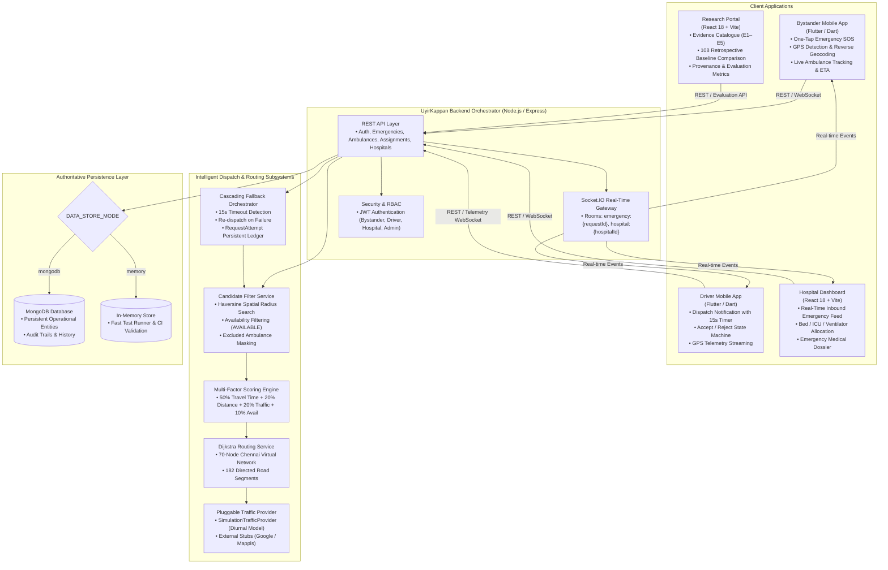

# UyirKappan — System Architecture Specification

## 1. High-Level Architecture Overview

UyirKappan is a **unified emergency response coordination platform** that coordinates four primary operational stakeholders across the critical emergency lifecycle:
1. **Bystanders / Patients** reporting emergency incidents and monitoring live ambulance response.
2. **Ambulance Drivers / Providers** receiving dispatch alerts, executing route navigation, and streaming vehicle telemetry.
3. **Emergency Hospital Departments** monitoring incoming ambulances, managing bed/ICU/ventilator capacity, and preparing triage bays.
4. **Research & Evaluation Teams** analyzing routing optimality, evaluating multi-factor candidate scoring, and benchmarking response times.

---

## 2. Component Breakdown

### 2.1 Backend Core (`backend/src/`)
- **Runtime**: Node.js v18+ / Express.js.
- **Real-Time Engine**: Socket.IO v4+ providing bidirectional event broadcasting to client rooms.
- **Persistence Layer**: Pluggable storage abstraction controlled via `DATA_STORE_MODE`:
  - `mongodb`: Production persistence via Mongoose schemas (`User`, `Ambulance`, `Hospital`, `EmergencyRequest`, `Assignment`, `RequestAttempt`, `LocationHistory`). Survives complete backend restarts.
  - `memory`: In-memory persistence maintaining full contract parity for high-speed unit and CI testing.

### 2.2 Intelligent Matcher & Dispatch (`backend/src/matcher/`)
- **Candidate Filtering**: [`CandidateFilterService`](file:///c:/Users/lenovo/Desktop/Uyirkappan-v2/backend/src/matcher/modules/dispatch/candidate-filter.service.js) computes spherical distance using the **Haversine formula** ($R = 6371\text{ km}$), filtering out busy ambulances and any units that previously rejected or timed out on this emergency.
- **Multi-Factor Scoring**: [`ScoringService`](file:///c:/Users/lenovo/Desktop/Uyirkappan-v2/backend/src/matcher/modules/dispatch/scoring.service.js) normalizes candidate metrics and calculates total weighted cost:
  $$\text{Score} = 0.50 \times \text{Time}_{\text{norm}} + 0.20 \times \text{Dist}_{\text{norm}} + 0.20 \times \text{Traffic}_{\text{norm}} + 0.10 \times \text{Avail}_{\text{norm}}$$
- **Routing Engine & Road Network Architecture**:
  The routing subsystem enforces a strict 4-layer architectural separation:
  - **Layer A (Source Geometry)**: `1ef735dc-2397-4dc3-88e8-d98ea0b8339b.kml` / `chennai_road_centerline.kml` remains immutable reference data (60,382 LineStrings, 741,740 coordinates).
  - **Layer B (Normalized Geometry)**: [`KmlParser`](file:///c:/Users/lenovo/Desktop/Uyirkappan-v2/backend/src/services/road-network/kml-parser.js) parses raw KML into normalized memory structures with bounding boxes and lengths.
  - **Layer C (Spatial Grid Index & Snapping)**: [`SpatialIndex`](file:///c:/Users/lenovo/Desktop/Uyirkappan-v2/backend/src/services/road-network/spatial-index.js) indexes segments across 421 uniform grid cells ($0.01^\circ \approx 1.1\text{ km}$), enabling sub-millisecond ($< 10\text{ ms}$) GPS-to-road snapping with perpendicular vector projection.
  - **Layer D (Routing Engine & Provider Abstraction)**: [`DijkstraService`](file:///c:/Users/lenovo/Desktop/Uyirkappan-v2/backend/src/matcher/modules/routing/dijkstra.service.js) computes traffic-weighted shortest paths across the verified 70-node / 182-segment (351 directed edges) graph. Pluggable routing providers are managed via [`RoutingProviderFactory`](file:///c:/Users/lenovo/Desktop/Uyirkappan-v2/backend/src/services/road-network/routing-provider.factory.js):
    - `ExistingGraphRoutingProvider`: Authoritative baseline operating over the 70-node network (Default: `ROUTING_GRAPH_SOURCE=existing`).
    - `KmlAugmentedRoutingProvider`: Enriches route inputs by snapping arbitrary GPS coordinates to real KML road centerlines before solving traffic-aware Dijkstra corridors.
- **Cascading Fallback**: [`FallbackOrchestratorService`](file:///c:/Users/lenovo/Desktop/Uyirkappan-v2/backend/src/matcher/modules/fallback/fallback-orchestrator.service.js) manages driver rejections and 15-second response timeouts by recording attempts in `RequestAttempt`, releasing the failed ambulance, and triggering automated re-dispatch on the same `requestId`.

### 2.3 Traffic Subsystem (`backend/src/services/traffic/`)
- **Active Operational Provider**: `SimulationTrafficProvider` models diurnal congestion variations based on time of day across 4 discrete states:
  - `NORMAL`: Multiplier 1.0x (Speed: ~40 km/h)
  - `MODERATE`: Multiplier 1.35x (Speed: ~29 km/h)
  - `HEAVY`: Multiplier 2.1x (Speed: ~19 km/h)
  - `BLOCKED`: Multiplier $\infty$ (Forces Dijkstra detour)
- **External Provider Adapters**: `GoogleTrafficProvider` and `MapplsTrafficProvider` are pluggable architectural adapters. When API credentials are unconfigured, they gracefully report `NOT_CONFIGURED` and safely delegate to `SimulationTrafficProvider`.

### 2.4 Client Applications
1. **Bystander App (`bystander_app/`)**: Flutter mobile application with responsive UI supporting compact displays ($320\text{px}$–$414\text{px}$), one-tap SOS submission, live ambulance vector map, and dynamic ETA display.
2. **Driver App (`driver_app/`)**: Flutter mobile application implementing a strict 10-state driver lifecycle finite-state machine, 15-second assignment response countdown, and navigation waypoints. Integrates a pluggable **Location Provider Subsystem**:
   - `LocationProvider`: Abstract contract decoupling business logic from location sources.
   - `RealGpsLocationProvider`: Production hardware GPS provider using `geolocator: ^13.0.2` with full permission management (`checkPermission`, `requestPermission`, `isLocationServiceEnabled`).
   - `SimulationLocationProvider`: Waypoint interpolation provider preserving reproducible offline demos and automated testing.
   - `GpsQualityFilter`: Evaluates coordinates ($[-90, 90]$, $[-180, 180]$), staleness, horizontal accuracy ($> 100\text{m}$ degraded badge), and impossible kinematic jumps ($> 180\text{ km/h}$).
   - `RealLocationService`: Dynamic orchestrator providing automatic graceful fallback from real GPS to simulation if hardware GPS is disabled or denied.
3. **Hospital Dashboard (`hospital-dashboard/`)**: React 18 + Vite emergency operations dashboard for hospital coordination, bed occupancy management, triage incoming cards, and emergency history:
   - **Role-Based Data Isolation**: Authenticated `HOSPITAL_STAFF` users are strictly isolated to their associated facility (`hospitalId`), ensuring incoming emergency feeds, bed capacity, and audit logs are segregated by hospital entity. System administrators retain full multi-hospital switching access.
   - **Situational Awareness & Live Radar**: Vector map radar tracking inbound ambulances with road-network geometry, dynamic ETAs continuously calculated by central routing engine, and automatic staleness warnings ($> 45\text{s}$).
   - **Telemetry Provenance Awareness**: Displays distinct indicators for `GPS LIVE (REAL DEVICE)` vs `GPS SIMULATION` based on backend telemetry metadata.
   - **Resource Management & Dispatch Feedback**: Synchronous updates for General Beds, ICU Beds, and Mechanical Ventilators; validated against total facility capacity and immediately propagated to the central Intelligent Matcher to prevent secondary patient transfers.
   - **Emergency Dossier & Fallback Audit Trail**: Full post-incident response archive, paramedic notes, and cascading fallback attempt history.
4. **Research Portal (`research-portal/`)**: React 18 + Vite portal presenting evidence demonstrations (E1–E5), 108 retrospective baseline comparison, and evaluation metrics.

### 2.5 Backend Telemetry Validation & Security
- **Coordinate Boundary Checks**: `PATCH /api/ambulances/{id}/location` strictly validates $-90.0 \le \text{lat} \le 90.0$ and $-180.0 \le \text{lng} \le 180.0$, rejecting non-numeric, infinite, or out-of-bounds coordinates with HTTP `400 Bad Request`.
- **Timestamp Freshness**: Rejects telemetry updates dated more than 5 minutes in the future.
- **RBAC & Ownership Enforcement**: Enforces that authenticated drivers can only update telemetry for their own assigned ambulance (`driver.ambulanceId === ambulance._id`); unauthorized drivers receive HTTP `403 Forbidden`, while system administrators retain emergency override capabilities.
- **Accuracy Ingestion**: Optional `accuracy` in meters is captured, persisted to `LocationHistory`, and emitted to frontend Socket.IO rooms (`AMBULANCE_LOCATION_UPDATED`).
